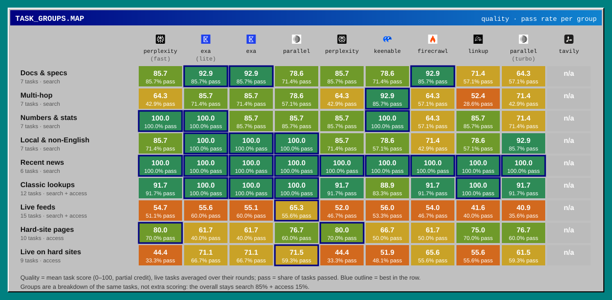

# SurfBench 🌊

**The benchmark that hires the best web assistant for your agent.**

SurfBench gives every web-access API the same 80 real tasks an agent gets asked — what are the default JIT cost thresholds in PostgreSQL 17, who won the 2026 Mercury Prize, wie hoch ist die Zugspitze, read this Instagram profile, what's MrBeast's latest video, what were last night's NFL scores — and checks whether the answer it found is right. Every task has ground truth: a verified answer key, or the official feed or API captured in the same round. **85% of the score is open-web search, 15% is access to hard sites.**


## Leaderboard

**Live site: [surf-bench.vercel.app](https://surf-bench.vercel.app)**: the [recap](https://surf-bench.vercel.app/results/runs/2026-10-26T16-07/recap.html), the [task inspector](https://surf-bench.vercel.app/results/runs/2026-10-26T16-07/inspect.html) (every provider × task cell with its search results, fetched pages, reader answer and verdict), and the [methodology page](https://surf-bench.vercel.app/results/runs/2026-10-26T16-07/methodology.html), which shows every prompt and answer key verbatim, generated from the code that ran. Full run package in the repo: [`results/runs/2026-10-26T16-07/`](results/runs/2026-10-26T16-07/REPORT.md).


How each provider did per group of tasks (quality and pass rate; [`groups.csv`](results/runs/2026-10-26T16-07/groups.csv)):



## How it works

Every provider runs the same fixed pipeline, with no per-provider tuning:

```
request ─▶ provider search (top 5) ─▶ provider fetch (top 3) ─▶ fixed reader model ─▶ answer ─▶ graded
```

- The request is sent **verbatim**: no rewriting, no `site:` filters. Finding the right site is part of the test.
- A single pinned reader model (MiniMax M3, temperature 0) answers **only from the fetched pages**, so no provider gets credit for model knowledge. This is enforced: a correct answer that is not in the pages the reader was given earns nothing.
- The 80 tasks are split into two tracks, weighted before the run:

| track | weight | tasks | what it asks |
|---|---|---|---|
| **search** | 85% | 56 | find the answer on the open web: docs and specs, multi-hop questions, official figures, long-tail and non-English facts, recent events, news and release feeds |
| **access** | 15% | 24 | open a given page, or get a live answer from a named bot-walled site (X, Instagram, Reddit, LinkedIn, Amazon, ESPN, Steam, the App Store…) |

- And three grading tiers:

| tier | tasks | graded against |
|---|---|---|
| **stable-read** | 10 | a given URL on a hard site (X, Instagram, NYT, Amazon, LinkedIn…); facts checked against a verified key |
| **stable-lookup** | 46 | a fixed fact the provider must find; verified key |
| **live-feed** | 24 | the official RSS / API captured **in the same round** (YouTube, Reddit, Hacker News, ESPN scores and standings, npm, PyPI, the App Store, Steam, Yahoo Finance, Bluesky, ECB rates…); on a named site, only what that site's own pages show counts |

Live tasks run 3 rounds. Each leg has a 30-second limit, and going over it is a DNF.

### Scoring

**Overall = 0.85 × search track + 0.15 × access track.** Each track is scored on:

| axis | weight | what it measures |
|---|---|---|
| **quality** | 0.55 | mean task score (0–1, partial credit) |
| **reliability** | 0.35 | share of tasks passed (score ≥ 0.8; live tasks also on-site) |
| **speed** | 0.10 | end-to-end median, relative to the fastest row in that track (floored at 25) |

- **Error bars, not just ranks.** A paired bootstrap over tasks gives each provider a 95% CI. Providers whose CI overlaps the leader's share a tie group.
- **Cost is a column, not a score**: $ per 1,000 passed tasks, from real call counts × list prices ([`src/lib/pricing.ts`](src/lib/pricing.ts), each with its source and date).
- **Fast modes are separate rows.** `exa (lite)`, `parallel (turbo)` and `perplexity (fast)` are ranked on their own and never merged into the default config. Exa and Parallel fast modes fetch with their parent's fetch API. Exa's legacy `fast` type is no longer ranked: it returned the same top 5 as `lite` on 118 of 131 searches.
- **Perplexity has no fetch API.** Its search returns each page's extracted text, and the top 3 results' text stands in for the fetch leg.
- **n/a, never zero.** Rate-limit and quota failures are excluded rather than scored. A provider needs ≥ 80% of each track's tasks scorable to get a number (Tavily was out of credits for this run).

### Known limits

- **Some hard sites have no official answer source.** Live questions on X, eBay, Zillow, Airbnb and similar marketplaces were dropped, because nothing public returns the true answer to grade against; X, Instagram, Amazon and LinkedIn are still tested as fixed-page reads. Live tasks exist only where a public API gives the true answer.
- **Answer keys are cross-checked by independent agents, not yet by a human.** The audit records this in `manifest.json`.
- **80 tasks is small.** Most of the field lands in overlapping CIs; ties are shown as ties.
- **One round of tool use.** This measures the search → fetch step an agent depends on, not a multi-step agent loop.
- **Live tasks are snapshots.** Compare providers within a run, not across runs.

## Run it yourself

```bash
git clone https://github.com/riccardogiorato/surf-bench.git
cd surf-bench
bun install
cp .example.env .env    # add the provider keys you have (all key-gated) + TOGETHER_API_KEY
bun run tasks           # run every provider over the 80 tasks
bun run tasks:grade     # reader + answer keys (offline, cached)
bun run tasks:report    # results/runs/<runId>/
bun run tasks:html      # recap, inspector, methodology pages + README SVGs
bun run tasks:audit     # publish gate
```

Providers: parallel · exa · tavily · firecrawl · keenable · linkup · perplexity, all key-gated (a missing key skips that provider). License: MIT.

## Web access map

Which famous hard sites each provider actually reached (passed / attempts, hardest first):


