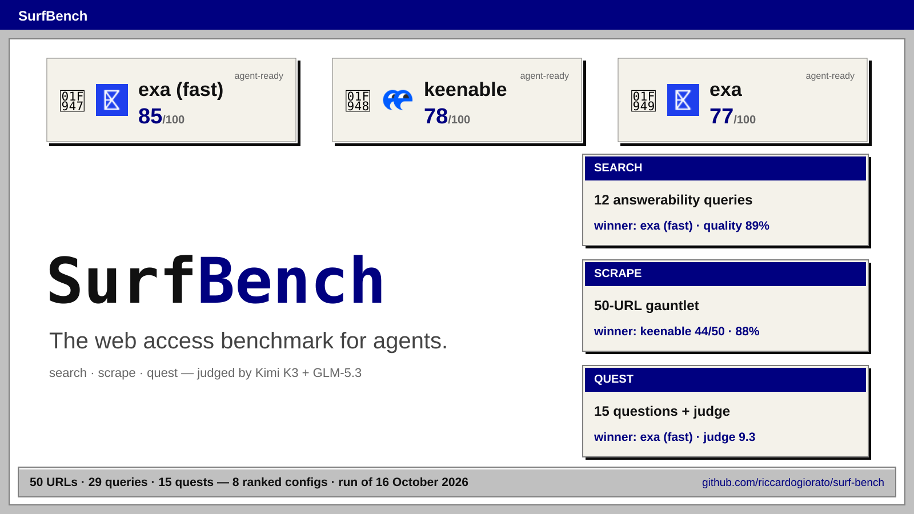
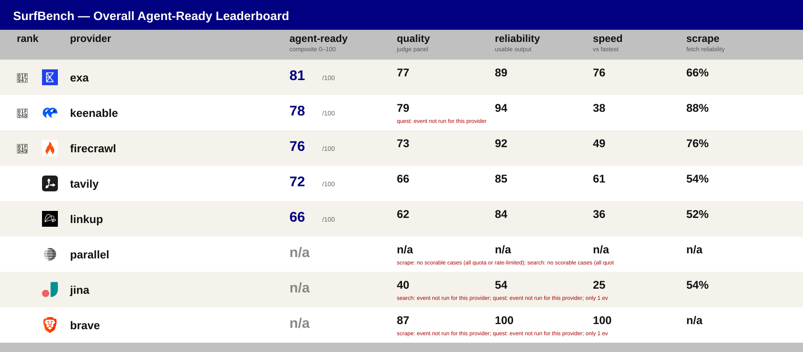

# SurfBench 🌊

**The benchmark that hires the best web assistant for your agent.**

SurfBench compares web-access APIs on the three things agents actually do: **search**, **scrape**, and **quest** (search → fetch → judge-graded answer). A Kimi K3 + GLM-5.3 judge panel grades the rides. Slow is a disqualification — the 30-second wipeout rule.



## Overall Agent-Ready Leaderboard — 16 October 2026



### How scoring works

Every provider is scored on three axes, averaged across the three events, then combined:

| axis | weight | what it measures |
|---|---|---|
| **quality** | 0.50 | judge-panel verdicts (0–10, Kimi K3 + GLM-5.3, averaged) — never string matching |
| **reliability** | 0.35 | share of cases that produced usable output |
| **speed** | 0.15 | median latency relative to the fastest config in each event (floored at 25) |

- **Search** — the ranked result set for each answerability query is graded on whether it lets an agent answer the question.
- **Scrape** — every one of the 50 extractions is graded on whether the page's main content is there. A scrape passes at ≥ 4/10 (partial content); blocks, login walls and empty responses score 0.
- **Quest** — search → fetch the top results → the panel grades whether the fetched content answers the question. A leg over 30s is a wipeout.
- **Fast modes are separate rows.** `exa (fast)` (search `type: "fast"`, index-only contents) and `parallel (turbo)` (search `mode: "turbo"`) are ranked on their own, never merged with the default config. Scrape has no fast mode, so they reuse their parent's scrape result.
- **n/a, never zero.** Rate-limit and quota failures are excluded rather than scored. An event needs ≥ 80% of cases scorable, and a composite needs quality plus ≥ 2 scored events — otherwise the provider shows `n/a`.

## Recommendation

**exa in fast mode is the best all-rounder (85).** It has the top search (8.9) and quest (9.3) judge scores and answers a quest in 1.5s. Its weak spot is scraping (66%): it refuses X, Reddit and eBay, and returns ~1,000-character previews of some news articles. **For scraping, keenable** gets the most usable pages (44/50, quality 73%) but is the slowest (10.6s median); firecrawl and parallel follow at 38/50. **parallel turbo** is the budget pick: 77 overall at about $2 per 1k searches + 1k fetches. keenable has no quest run yet, so its composite covers search and scrape only.

**Pricing at 1,000 searches + 1,000 scraped URLs** (list prices, September 2026):

| leg | exa | parallel | parallel turbo | keenable |
|---|---|---|---|---|
| 1,000 searches | $7 ([search](https://exa.ai/pricing)) | $5 ([search basic/advanced](https://docs.parallel.ai/getting-started/pricing)) | **$1** ([search turbo/fast](https://docs.parallel.ai/getting-started/pricing)) | $4 ([pay as you go](https://keenable.ai/pricing); $1 at 100 RPS+ dedicated tier) |
| 1,000 scraped URLs | $1 ([contents](https://exa.ai/pricing)) | $1 ([extract](https://parallel.ai/products/extract)) | $1 ([extract](https://parallel.ai/products/extract)) | $4 per 1,000 fetches (1 credit each) |
| **total / 1k+1k** | **$8** | **$6** | **$2** | **$8** ($0 within the 100k free requests/mo) |

Both give free credits to start. Prices are list rates — confirm on the vendors' pricing pages before committing.

Full per-event leaderboards, methodology, and judge details: [results/README.md](results/README.md).

## Run it yourself

```bash
git clone https://github.com/riccardogiorato/surf-bench.git
cd surf-bench
bun install
cp .example.env .env   # add the provider keys you have (all key-gated)
bun run test           # all three events
bun run report         # rebuild results/summary.json + leaderboard SVG
```

Providers: firecrawl · exa · linkup · tavily · parallel · jina · brave · serper · keenable — all key-gated, absent keys skip that provider. Judge panel: Kimi K3 + GLM-5.3 via Together AI, verdicts cached by content hash. Concurrency capped per provider. License: MIT.