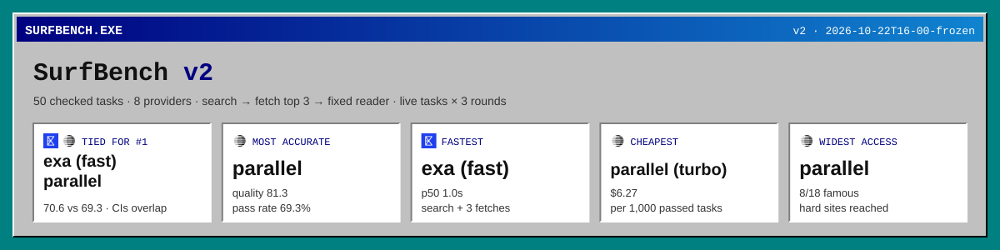
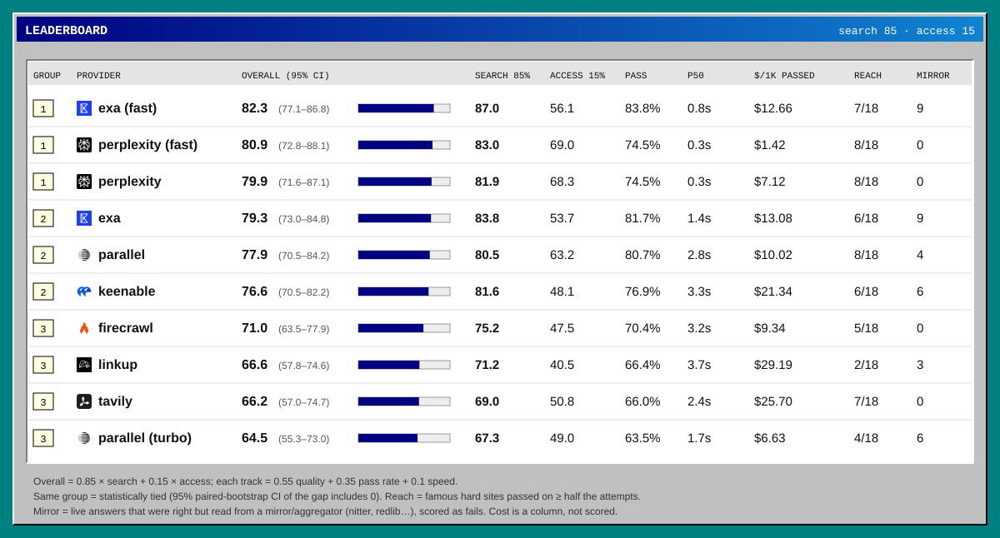
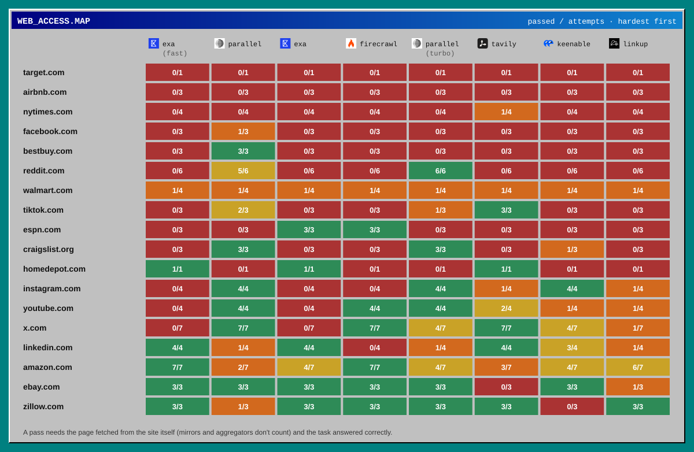

# SurfBench 🌊

**The benchmark that hires the best web assistant for your agent.**

SurfBench gives every web-access API the same 50 real tasks an agent gets asked — read this Instagram profile, what are the top posts on r/LocalLLaMA this week, find a 2-bedroom home in Austin under $500k on Zillow — and checks whether the answer it found is right.



## How it works

Every provider runs the same fixed pipeline, with no per-provider tuning:

```
request ─▶ provider search (top 5) ─▶ provider fetch (top 3) ─▶ fixed reader model ─▶ answer ─▶ graded
```

- The request is sent **verbatim**: no rewriting, no `site:` filters. Finding the right site is part of the test.
- A single pinned reader model (MiniMax M3, temperature 0) answers **only from the fetched pages**, so no provider gets credit for model knowledge.
- The 50 tasks come in four tiers:

| tier | tasks | graded against |
|---|---|---|
| **stable-read** | 10 | a given URL on a hard site (X, Instagram, NYT, Amazon, LinkedIn…); facts checked against a verified key |
| **stable-lookup** | 12 | a fixed fact the provider must find; verified key |
| **live-feed** | 12 | items captured from the official RSS / API **in the same round** (Reddit, Hacker News, NYT, BBC, YouTube, GitHub…) |
| **live-judge** | 16 | no key possible (X posts, eBay, Zillow, Airbnb…): yes/no constraints checked by a Kimi K3 + GLM-5.3 panel, including "on the site itself, not a mirror" and "dated within N days" |

Live tasks run 3 rounds. Each leg has a 30-second limit, and going over it is a DNF.

## Leaderboard

Full run package: [`results/runs/2026-10-22T16-00-frozen/`](results/runs/2026-10-22T16-00-frozen/REPORT.md). It includes per-task evidence, the [task inspector](results/runs/2026-10-22T16-00-frozen/inspect.html) (every provider × task cell with its search results, fetched pages, reader answer and verdict), and the [methodology page](results/runs/2026-10-22T16-00-frozen/methodology.html), which shows every prompt, rubric and answer key verbatim, generated from the code that ran.





### Scoring

| axis | weight | what it measures |
|---|---|---|
| **quality** | 0.50 | mean task score (0–1, partial credit) |
| **reliability** | 0.35 | share of tasks passed (score ≥ 0.8; live tasks also on-site and fresh) |
| **speed** | 0.15 | end-to-end median, relative to the fastest row (floored at 25) |

- **Error bars, not just ranks.** A paired bootstrap over tasks gives each provider a 95% CI. Providers whose CI overlaps the leader's share a tie group.
- **Cost is a column, not a score**: $ per 1,000 passed tasks, from real call counts × list prices ([`src/lib/pricing.ts`](src/lib/pricing.ts), each with its source and date).
- **Fast modes are separate rows.** `exa (fast)` and `parallel (turbo)` are ranked on their own and never merged into the default config. They fetch with their parent's fetch API.
- **n/a, never zero.** Rate-limit and quota failures are excluded rather than scored. A provider needs ≥ 80% of tasks scorable to get a number.

### Known limits

- **16 live-judge tasks have no ground truth.** The panel checks explicit constraints, not that an item is *the* newest. The judges' agreement with independent blind labels is published in `calibration.json`.
- **Answer keys are cross-checked by independent agents, not yet by a human.** The audit records this in `manifest.json`.
- **50 tasks is small.** Most of the field lands in overlapping CIs; ties are shown as ties.
- **One round of tool use.** This measures the search → fetch step an agent depends on, not a multi-step agent loop.
- **Live tasks are snapshots.** Compare providers within a run, not across runs.

## Run it yourself

```bash
git clone https://github.com/riccardogiorato/surf-bench.git
cd surf-bench
bun install
cp .example.env .env    # add the provider keys you have (all key-gated) + TOGETHER_API_KEY
bun run tasks           # run every provider over the 50 tasks
bun run tasks:grade     # reader + answer keys + judge panel (offline, cached)
bun run tasks:report    # results/runs/<runId>/
bun run tasks:html      # recap, inspector, methodology pages + README SVGs
bun run tasks:audit     # publish gate
```

Providers: parallel · exa · tavily · firecrawl · keenable · linkup, all key-gated (a missing key skips that provider). License: MIT.
